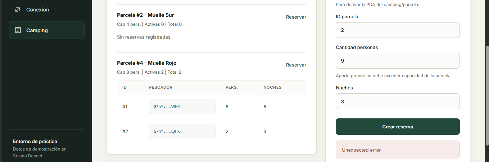

<div align="center">


# CAMPING DE PESCA

### *Sistema on-chain de reservas de parcelas y pesca en Solana*

[](https://explorer.solana.com/address/EVCkpvMZhRSFcKTFBdUnBvf4exj88dPopsGawfY7sPXD?cluster=devnet)
[](https://www.anchor-lang.com/)
[](https://www.rust-lang.org/)
[](https://github.com/codama-idl/codama)
[](https://react.dev/)
[](https://www.typescriptlang.org/)

<br/>

**[🔍 Solana Explorer (Devnet)](https://explorer.solana.com/address/EVCkpvMZhRSFcKTFBdUnBvf4exj88dPopsGawfY7sPXD?cluster=devnet)** &nbsp;·&nbsp;
**[📦 Programa (`programa/`)](programa/)** &nbsp;·&nbsp;
**[💻 Frontend (`frontend/`)](frontend/)**

<br/>

🎓 Desarrollado para el bootcamp **WayLearn — Solana Engineering Track: Advanced** (2026).

</div>

---

## Resumen

En un camping de pesca, cada jornada mezcla dos ritmos distintos: quien organiza el predio y los sectores habilitados, y quien llega con su equipo a reservar una parcela para pasar unas noches y pescar. Cuando el control se lleva por separado o sin límites claros por parcela, aparecen cruces de cupo, dudas sobre quién reservó qué y cierres de sectores hechos a destiempo.

Este proyecto implementa `camping_pesca` sobre **Solana Devnet** usando **Anchor**, un cliente tipado generado con **Codama** (`frontend/clients/js/src/generated/`) y una aplicación web en **React + Vite**. Las cuentas PDA modelan la jerarquía entre camping, parcela y reserva, mientras las reglas de capacidad y cierre quedan aplicadas directamente en el programa on-chain.

---

## Problema y aporte propio

| Rol | Desafío operativo |
|-----|-------------------|
| 🏕️ **Administrador del camping** | Necesita crear parcelas con capacidad acotada (1 a 10 personas) y cerrarlas de forma segura sin afectar reservas vigentes |
| 🎣 **Pescador** | Necesita crear, modificar y cancelar reservas vinculadas de forma verificable a una parcela y a su wallet |
| 🔍 **Evaluador / Revisor** | Necesita comprobar transiciones de estado on-chain y rechazos explícitos cuando se incumplen las reglas del negocio |

### Aporte propio (más allá del template base)

1. **Validación de capacidad on-chain (`CapacidadExcedida`):** Toda reserva nueva o modificada exige `cantidad_personas <= parcela.capacidad_personas` directamente dentro del programa Anchor —no solo en la interfaz—, rechazando cualquier intento de sobreocupación con `ErrorCamping::CapacidadExcedida`.
2. **Cierre condicionado de parcelas (`ParcelaConReservasActivas`):** El cierre de una parcela exige `reservas_activas == 0` (devolviendo la renta al administrador mediante `close = admin`) sin retroceder el contador histórico `total_parcelas`.

---

## Arquitectura y modelo de cuentas (PDAs)

```text
                 Wallet (Phantom / Solflare / Backpack)
                                    │
                                    ▼
                 Frontend React + Vite (Cliente Codama)
         Acciones Admin · Acciones Pescador · Enlaces Explorer
                                    │
                            firma y envía
                                    ▼
        ┌───────────────────────────────────────────────────────┐
        │                  ON-CHAIN (Solana Devnet)             │
        │                                                       │
        │  Programa Anchor: camping_pesca                       │
        │  Program ID: EVCkpvMZhRSFcKTFBdUnBvf4exj88dPopsGawfY7sPXD│
        │                                                       │
        │  • Camping PDA  ──▶ seeds: ["camping", admin.key()]   │
        │  • Parcela PDA  ──▶ seeds: ["parcela", camping, id]   │
        │  • Reserva PDA  ──▶ seeds: ["reserva", parcela, id]   │
        └───────────────────────────────────────────────────────┘
```

Relación entre entidades: **`Camping (1) -> (N) Parcela (1) -> (N) Reserva`**, utilizando derivación determinista de seeds y restricciones de Anchor (`has_one`, `close`) para garantizar la pertenencia y autorización.

| Cuenta | Seeds | Campos principales | Rol |
|--------|-------|--------------------|-----|
| `Camping` | `["camping", admin.key()]` | `admin: Pubkey`, `nombre: String(32)`, `total_parcelas: u64`, `bump: u8` | Cuenta raíz por administrador |
| `Parcela` | `["parcela", camping.key(), id_u64_le]` | `camping: Pubkey`, `id: u64`, `sector: String(24)`, `capacidad_personas: u8(1..10)`, `reservas_activas: u64`, `total_reservas: u64`, `bump: u8` | Recurso reservable con contadores activos e históricos |
| `Reserva` | `["reserva", parcela.key(), id_u64_le]` | `parcela: Pubkey`, `pescador: Pubkey`, `id: u64`, `cantidad_personas: u8`, `noches: u8`, `bump: u8` | Reserva creada por una wallet pescador |

---

## Instrucciones del contrato inteligente

| Instrucción | Autoridad / Firmante | Regla crítica |
|-------------|----------------------|---------------|
| `inicializar_camping(nombre)` | `admin` | Crea la cuenta PDA `Camping` del administrador |
| `crear_parcela(sector, capacidad_personas)` | `admin` (`has_one = admin`) | Valida `capacidad_personas` entre `1` y `10`; incrementa `total_parcelas` y asigna `id` correlativo |
| `crear_reserva(cantidad_personas, noches)` | `pescador` | Exige `noches >= 1`, `cantidad_personas >= 1` y `cantidad_personas <= parcela.capacidad_personas` (si no, `CapacidadExcedida`); incrementa `reservas_activas` y `total_reservas` |
| `modificar_reserva(nuevas_personas, nuevas_noches)` | `pescador` (`has_one = pescador`, `has_one = parcela`) | Verifica pertenencia a la misma parcela y revalida `nuevas_personas <= parcela.capacidad_personas` |
| `cancelar_reserva()` | `pescador` (`has_one = pescador`, `has_one = parcela`) | Cierra la cuenta `Reserva` (`close = pescador`) y decrementa `reservas_activas` |
| `cerrar_parcela()` | `admin` (`has_one = admin`, `has_one = camping`) | Exige `reservas_activas == 0` (si no, `ParcelaConReservasActivas`); cierra `Parcela` (`close = admin`) sin decrementar `total_parcelas` |

---

## Estructura del repositorio

```text
programa/
  src/lib.rs                  # Programa Anchor camping_pesca
  tests/anchor.test.ts        # Pruebas de flujos válidos y rechazos
frontend/
  programa/src/lib.rs         # Copia sincronizada del código fuente del programa
  public/logo-camping-pesca.png
  idl.json                    # IDL del programa
  codama.json                 # Configuración de generación Codama
  scripts/                    # configurar-idl, generar-cliente, verificar-contrato
  clients/js/src/generated/   # Cliente generado con Codama (cuentas, instrucciones, PDAs, errores)
  src/config/                 # programa.json, interfaz.ts, aula.json
  src/solana/                 # pdas, seeds, acciones, lecturas, validaciones, tx, seguridad
  src/components/             # Conexion.tsx, Registro.tsx, etc.
  src/App.tsx
```

---

## Cómo levantar el proyecto en local

### Requisitos previos
- Entorno Linux / WSL con Rust, Solana CLI y Anchor CLI
- Node.js `>=22.12.0 <25` y `npm`
- Wallet de navegador configurada en **Devnet** (Phantom, Solflare o Backpack) con SOL de prueba

### 1. Compilar y desplegar el programa (WSL)

```bash
export PATH="$HOME/.cargo/bin:$HOME/.local/share/solana/install/active_release/bin:$HOME/.avm/bin:$PATH"
cd programa
anchor build
anchor deploy --provider.cluster devnet
```

### 2. Configurar IDL y levantar el frontend

```bash
cd frontend
npm install
npm run configurar:idl -- ../programa/target/idl/camping_pesca.json --program-id EVCkpvMZhRSFcKTFBdUnBvf4exj88dPopsGawfY7sPXD
npm run comprobar:idl
npm run dev
```

Abrir `http://localhost:5173` en el navegador (reiniciar Vite si ya estaba corriendo antes de actualizar el IDL).

Comandos útiles en `frontend/`:

```bash
npm run cliente
npm run comprobar:idl
npm run typecheck
npm run build
```

---

## Despliegue en Devnet

| Campo | Valor |
|-------|-------|
| **Red** | Solana Devnet |
| **Program ID** | `EVCkpvMZhRSFcKTFBdUnBvf4exj88dPopsGawfY7sPXD` |
| **IDL utilizado** | `frontend/idl.json` |
| **Explorer** | [Ver programa en Solana Explorer](https://explorer.solana.com/address/EVCkpvMZhRSFcKTFBdUnBvf4exj88dPopsGawfY7sPXD?cluster=devnet) |

## Evidencias en Devnet

- **Programa desplegado:** `EVCkpvMZhRSFcKTFBdUnBvf4exj88dPopsGawfY7sPXD` — https://explorer.solana.com/address/EVCkpvMZhRSFcKTFBdUnBvf4exj88dPopsGawfY7sPXD?cluster=devnet
- **Operaciones probadas en UI (Devnet):** inicializar camping, crear parcela, crear/modificar/cancelar reserva y cerrar parcela vacía.
  - Firma de ejemplo (inicializar camping): `kM8GX…81MB1` (03:45:50 UTC) — reemplazar `[FIRMA_COMPLETA]` por el hash completo desde Solana Explorer: `https://explorer.solana.com/block/525300292?cluster=devnet`
- **Validación de rechazo probada:** intento de crear reserva en Parcela #2 (capacidad 4) con 9 personas desde la UI, rechazado por regla de capacidad.


---

## Alcance y limitaciones

- Este proyecto es un **prototipo en Devnet** centrado en la gestión de estado y validación de reglas on-chain; pagos/escrow, bases de datos off-chain y auditorías de producción quedan fuera del alcance actual.
- Las pruebas automatizadas se encuentran en `programa/tests/anchor.test.ts` y `frontend/tests/integracion-cliente.test.ts`, complementadas con pruebas manuales en Devnet desde la interfaz web.

---

<div align="center">

## Autora

Desarrollado por **Beverly J. Licette Gonzalez Casanova** ([@licette32](https://github.com/licette32)).

---

**Camping de Pesca · Prototipo en Solana Devnet · 2026**

*Sistema on-chain de reservas de parcelas y pesca construido con Anchor y Codama.*

</div>